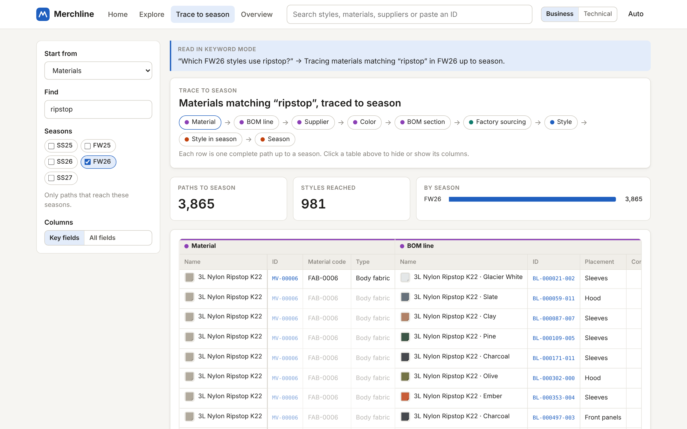
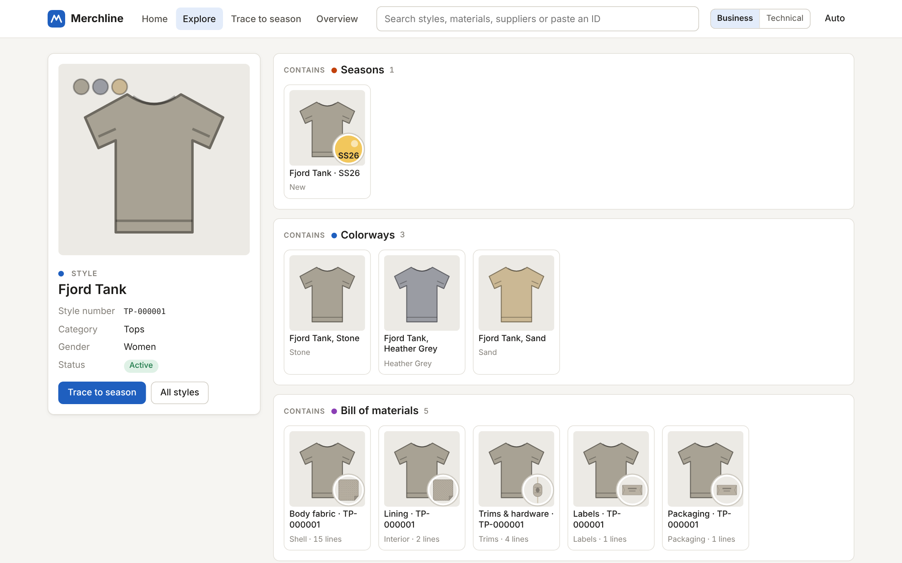
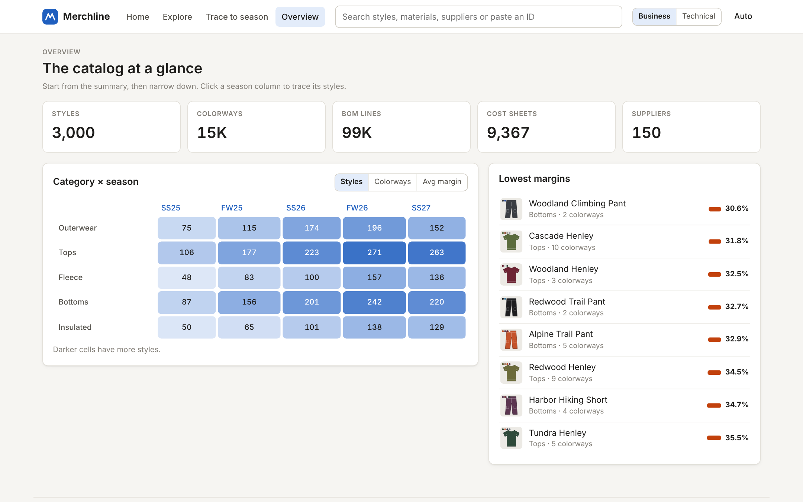
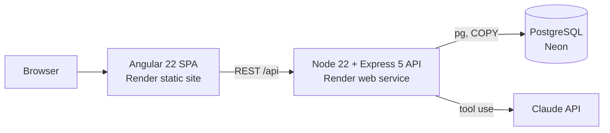

# Merchline

[](https://github.com/sharathhchandrasehkar/merchline/actions/workflows/ci.yml)     

**A product lifecycle data explorer for retail and apparel, with a Claude-powered natural-language query layer.**

Merchline turns a 15-table PLM data model (seasons, styles, colorways, BOMs, sourcing, cost sheets, suppliers, materials and colors) into something a merchandiser can actually use. Open any record and see everything linked to it. Trace any material, colorway, BOM line or cost sheet back to the season it sells in. Or just ask: *"Which FW26 styles use ripstop?"*

> **Live demo:** _add your Render URL here_ · The free server sleeps when idle, so the first load can take about a minute.



## Generative AI: Ask Merchline

Product teams think in questions, not joins. *Ask Merchline* lets them type a question in plain English and get back a full trace-to-season report.

- **Claude tool use with a forced tool call.** The API sends the question to Claude along with a `run_trace` tool whose schema is built from the data model: the start table is an enum of traceable tables, and seasons are an enum of real season codes. `tool_choice` forces Claude to answer with that structured call, never with free text.
- **Validated before it touches the database.** The tool input is checked with zod. Every field maps to a parameterised query, so the model can choose *what* to trace but never writes SQL.
- **Explainable.** Claude returns a one-line explanation that the UI shows above the report ("Tracing materials matching 'ripstop' in FW26 up to season"), so users can see how their question was read.
- **Graceful fallback.** With no `ANTHROPIC_API_KEY`, a keyword parser handles the same questions (season codes, "spring/summer 2026", synonyms such as *vendor* or *mill*, and fuzzy library lookups), so the demo never breaks.

See [`server/src/lib/ask.ts`](server/src/lib/ask.ts).

## Features

| | |
|---|---|
| **Home** | Plain-language entry points grouped by lifecycle stage (Plan → Design → Build → Source & cost), with live counts and thumbnails |
| **Explore** | Every table as a searchable, paged grid of visual tiles |
| **Record board** | One record on the left, every parent and child relationship as a wall of tiles on the right, with a breadcrumb of the path you walked |
| **Trace to season** | Picks any of 8 starting tables, walks every join up to Season, and returns one row per path with all properties grouped by table. Includes season filters, path summaries, column toggles and CSV export |
| **Overview** | Category × season heatmap (styles, colorways or average margin) and a lowest-margin watch list |
| **Business / Technical** | One switch changes labels from business names ("Colorways") to table names (`Sku`) and shows IDs and join keys |
| **Themes** | Light, dark and system |

| Record board | Overview |
|---|---|
|  |  |

## Architecture



- **Metadata-driven API.** One model file ([`server/src/model.ts`](server/src/model.ts)) describes the 15 entities and 21 relationships. Listing, record views, relationship paging, search and the UI labels all come from it, so adding a table means adding metadata rather than endpoints.
- **Trace engine.** [`server/src/lib/trace.ts`](server/src/lib/trace.ts) defines the join chain from each start table to Season and emits one query that returns each table as a JSON column (`to_jsonb(alias)`), plus a `GROUPING SETS` summary by season. At 3,000 styles (about 175k rows), a page of rows returns in under 100 ms.
- **Synthetic catalog at scale.** A deterministic generator streams roughly 175k realistic rows into Postgres with `COPY`, then builds FK and trigram (`pg_trgm`) indexes. The API seeds itself on first boot, so a fresh deployment needs no manual steps.
- **Thumbnails without image storage.** Each row stores a small JSON recipe (garment silhouette and colorway, fabric texture, swatch, factory, cost bar) that the client renders as SVG.
- **Angular 22.** Standalone components, signals, zoneless change detection, the new control flow, lazy-loaded routes and router input binding.

## Tech stack

**Frontend:** Angular 22, TypeScript, signals, CSS custom properties
**Backend:** Node.js 22, Express 5, TypeScript, zod, Anthropic SDK
**Database:** PostgreSQL 17 (Neon serverless), `pg`, `pg-copy-streams`, `pg_trgm`
**Testing and CI:** `node:test` + supertest (24 API integration tests), GitHub Actions with a Postgres service
**Hosting:** Render (static site + web service) and Neon, all on free tiers

## Run it locally

You need **Node.js 22+** and **Git**. Docker and a Postgres install aren't needed, because the project runs an embedded Postgres for development.

```bash
git clone https://github.com/sharathhchandrasehkar/merchline.git
cd merchline
npm run setup      # installs root, server and web; creates server/.env
npm run dev        # database :5433, API :3000, web http://localhost:4200
```

The first start loads 3,000 synthetic styles, which takes about 30 seconds. Then open http://localhost:4200.

**In VS Code:** open the folder and accept the recommended extensions. Run the task *Merchline: setup (first time)* once, then press **Ctrl+Shift+B** to start everything. **Run and Debug → Full stack** starts the API and web app with breakpoints. The SQLTools extension comes preconfigured to browse the local database.

Run the API tests with the VS Code task *API: tests*, or `npm test` with `DATABASE_URL` pointing at a test database. They wipe and reseed that database.

To enable Claude, set `ANTHROPIC_API_KEY` in `server/.env` and restart the API.

## Deploy for free

See [docs/DEPLOY.md](docs/DEPLOY.md). In short: create a Neon project, click **New → Blueprint** on Render, point it at this repo, and paste the Neon connection string. `render.yaml` sets up the rest.

## Project layout

```
server/            Express API
  src/model.ts       data model metadata (entities, relations)
  src/lib/           records, trace engine, stats, Ask (Claude)
  src/seed/          schema, synthetic data generator, COPY loader
  test/              API integration tests
web/               Angular app
  src/app/pages/     home, explore, record board, trace, overview
  src/app/shared/    thumbnail renderer, tiles, Ask box
render.yaml        Render blueprint (API + static site)
```

## License

MIT. All demo data is synthetic.
